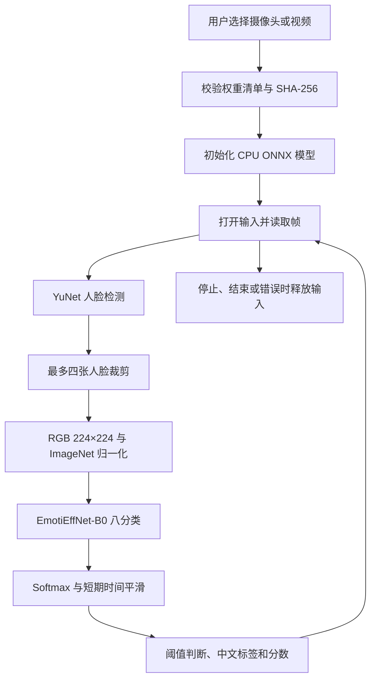

# 实时表情识别工作流

更新：2026-10-15。

本文说明摄像头／视频识别的处理流程。静态研究方案见 [基线对比实验](BASELINE_EXPERIMENTS.md)。

## 1. 实时识别工作流

### 输入与预处理

- 摄像头自动模式依次尝试编号 0–3，每个编号先 DirectShow、后 Media Foundation；实际读到帧才采用。手动模式只尝试指定编号。
- 摄像头请求 640×480，支持镜像；视频从文件顺序读取。
- 处理图最长边不超过 960，检测图最长边不超过 640。
- YuNet 检测阈值 0.8、NMS 阈值 0.3；取面积最大的四张脸，框周围增加约 3% 边缘，跳过不足 24 像素的裁剪。
- 裁剪转 RGB、缩放为 224×224，使用 ImageNet 均值 `[0.485, 0.456, 0.406]` 与标准差 `[0.229, 0.224, 0.225]`，生成 float32 NCHW 输入。

### 分类与显示

使用 `enet_b0_8_best_afew.onnx`，输出顺序为：愤怒、轻蔑、厌恶、恐惧、高兴、中性、悲伤、惊讶。

短期轨迹以 IoU ≥ 0.3 贪心一对一匹配，时间平滑系数为 `1 - exp(-dt / 0.22)`，历史最多保留 0.6 秒。轨迹编号不代表人物身份，多人交叉时仍可能匹配错误。

默认最高分低于 0.45 显示“不确定”，无检测框时不做表情判断。下方两列分数显示最大人脸。分数未经校准，不代表预测正确率或真实内心情绪。

### 运行与资源释放

Tk 主线程负责显示，工作线程负责采集和推理；预览队列仅保留最新结果。视频逐帧推理，处理较慢时播放减速；界面忙碌时可能不展示每个中间结果。当前不播放音轨、不导出标注视频。

运行中可暂停／继续，停止后才能切换来源。停止、读到视频末尾及异常路径都会释放输入。关闭时等待工作线程最多四秒，底层摄像头驱动阻塞仍可能导致延迟。

## 2. 验证状态与限制

实时核心代码已上传；本地 7 项单元测试，以及真实 ONNX 八类输出、分数和与空白帧检查通过。72 帧样本视频全部处理完成。摄像头编号 0 成功读取 12 帧，但当时未检测到人脸，因此不能据此确认真人表情精度。

此前 12 个静态样本检测与分类耗时中位数约 24.07 ms、P95 25.68 ms；不包含完整 GUI 显示链路，不能当作稳定 FPS 或通用速度保证。窗口布局和设备切换仍需本机人工验收。

## 3. 与静态实验的关系

实时应用使用公开 EmotiEffNet-B0 八分类权重；FER2013 实验采用独立七分类网络，不含轻蔑，标签顺序也不同。两条路线不能按类别索引直接比较，静态实验结果也不能当作当前实时模型的准确率。

## 4. 仓库范围

当前仓库保存实时核心代码及说明。模型、数据集和用户视频不上传，应用不录制或上传摄像头画面。本次文档调整不启用 GitHub Actions；测试按 README 在本地执行。
