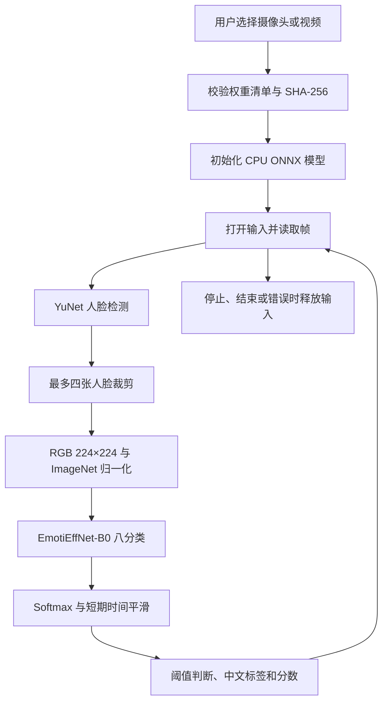

# 工作流与基线对比实验总结

更新：2026-10-15。

## 1. 当前完成情况

项目包含两条独立路线：**实时部署**使用公开 EmotiEffNet-B0 权重完成摄像头／视频识别；**静态研究**设计 FER2013 基线与类内可靠性加权实验。

| 内容 | 当前状态 | 可得结论 |
| --- | --- | --- |
| 实时应用 | 核心代码已上传，CPU ONNX 可运行 | 可进行本地功能演示 |
| 实时单元测试 | 本地 7 项通过 | 输入归一化、摄像头回退、轨迹等逻辑通过相应检查 |
| 真实模型检查 | 八类输出、分数和及空白帧检查通过 | 权重能够加载并产生预期形状输出 |
| 视频功能测试 | 72 帧样本序列全部处理 | 本次视频管线运行完整 |
| 摄像头测试 | 编号 0 读取 12 帧；当时检测到的人脸数为 0 | 已验证读取，未验证真人表情精度 |
| FER2013 数据审计 | 本地已完成像素完全重复检查 | 可建立排除跨划分重复的评估掩码 |
| 基线训练与对比 | 本地保留实验代码，尚无已完成的训练结果 | 不能声称候选方法优于基线 |

本仓库此前按要求只上传实时核心文件。本次新增总结文档，不上传本地 `ferlab` 训练框架、数据或模型；下文训练命令针对保留完整实验代码的本地项目，**仅克隆当前仓库不能运行这些训练命令**。

## 2. 实时识别工作流



### 输入与预处理

- 摄像头自动模式依次尝试编号 0–3，每个编号先 DirectShow、后 Media Foundation；实际读到帧才采用。手动模式只尝试指定编号。
- 摄像头请求 640×480，支持镜像；视频从文件顺序读取。
- 处理图最长边不超过 960，检测图最长边不超过 640。
- YuNet 检测阈值 0.8、NMS 阈值 0.3；取面积最大的四张脸，框周围增加约 3% 边缘，跳过不足 24 像素的裁剪。
- 裁剪转 RGB、缩放为 224×224，使用 ImageNet 均值 `[0.485, 0.456, 0.406]` 与标准差 `[0.229, 0.224, 0.225]`，生成 float32 NCHW 输入。

### 分类与显示

使用 `enet_b0_8_best_afew.onnx`，输出顺序为：愤怒、轻蔑、厌恶、恐惧、高兴、中性、悲伤、惊讶。

短期轨迹以 IoU ≥ 0.3 贪心一对一匹配，时间平滑系数为 `1 - exp(-dt / 0.22)`，历史最多保留 0.6 秒。轨迹编号不代表人物身份，多人交叉时仍可能匹配错误。

默认最高分低于 0.45 显示“不确定”，无检测框时不做表情判断。下方两列分数显示最大人脸。分数未经校准，不代表预测正确率或真实内心情绪。

### 运行与资源释放

Tk 主线程负责显示，工作线程负责采集和推理；预览队列仅保留最新结果。视频逐帧推理，处理较慢时播放减速；界面忙碌时可能不展示每个中间结果。当前不播放音轨、不导出标注视频。

运行中可暂停／继续，停止后才能切换来源。停止、读到视频末尾及异常路径都会释放输入。关闭时等待工作线程最多四秒，底层摄像头驱动阻塞仍可能导致延迟。

## 3. 静态基线对比：要回答什么问题

研究假设：使用全局置信度降低噪声样本权重时，少数类的正确难样本也可能被压低；混合全局排序与类内排序，可能在抑制错误标签的同时保留少数类学习信号。

这是假设，不是已验证创新。教师预测置信度不能直接当作标签正确概率；类内排序也可能保留系统性错标。

### 数据与公平设置

| 项目 | 设置 |
| --- | --- |
| 数据 | FER2013 图片版，48×48 灰度，七分类 |
| 标准划分 | train 28,709 / val 3,589 / test 3,589 |
| 排重划分 | val 3,309 / test 3,275；排除先前划分中像素完全一致的样本 |
| 骨干 | SmallInputResNet18，基础通道 16，随机初始化 |
| 首轮预算 | 12 epochs，warmup 3，batch size 256 |
| 优化 | AdamW，学习率 0.001，weight decay 0.0001，余弦衰减 |
| 随机种子 | 42、2026、3407，各方法使用配对种子 |
| 增强 | 双视图，随机水平翻转、轻微平移、对比度扰动 |
| 选择模型 | 排重验证集 macro-F1 最高的 checkpoint |

这是小输入、窄通道残差网络先导实验，不是标准 ImageNet 预训练 ResNet-18，也不是 SCN 等论文的完整复现。所有方法共享初始化规则、样本顺序、增强和优化器；仍需报告时间成本差异，不能将同 epoch 数理解为同 FLOPs。

像素审计发现 557 个跨划分重复组，57 个标签冲突重复组；这些数量来自当前本地数据版本。排重不能消除近重复、划分内部重复或人物身份泄漏。

## 4. 对比组与消融

| 方法 | 类别加权 | 双视图 JS 一致性 | EMA 教师可靠性 | 用途 |
| --- | --- | --- | --- | --- |
| `ce` | 无 | 无 | 无 | 普通交叉熵基线；仍使用同样双视图训练 |
| `balanced` | 有 | 无 | 无 | 检验类别不平衡处理的收益 |
| `consistent` | 有 | 有 | 无 | 检验一致性正则的增量收益 |
| `global` | 有 | 有 | 全局排序，α=0 | 可靠性加权基线 |
| `classwise` | 有 | 有 | 全局／类内混合，α=0.5 | 候选方法 |
| `no_floor` | 有 | 有 | 同混合排序，权重下限=0 | 去除权重下限的消融 |

首轮运行前五种方法，共 **5×3=15 次训练**；加入 `no_floor` 后共 18 次。`no_floor` 不在默认 suite 列表中，需显式指定。

类别权重由训练标签计数的平方根倒数得到，按类别均值归一化后裁剪到 `[0.5, 3]`。教师参数 EMA 衰减为 0.99；每轮结束用教师对训练集推理，计算：

```text
margin_i = p_teacher(observed_label_i) - max(p_teacher(other_labels))
r_i = (1 - α) × global_percentile(margin_i)
      + α × within_observed_class_percentile(margin_i)
w_i = floor + (1 - floor) × r_i
```

默认 floor=0.2。并列分数取平均秩，避免文件顺序决定权重。权重用于下一轮，预热后渐进启用；可靠性计算仅使用训练集，不引入验证或测试标签。

两视图交叉熵取平均后，按类别权重和渐进样本权重加权并归一化；一致性方法额外加 `0.1 × ramp × JS`。`global` 与 `classwise` 的主要差异应只保留 α，以便解释类内排序的作用。

## 5. 执行顺序与命令

以下命令仅供**本地完整项目**使用；当前 GitHub 核心版本不包含 `ferlab`。训练另需 NumPy、Pillow 和合适版本的 PyTorch。

```powershell
# 1. 准备指定格式的 FER2013 JPG ZIP，生成数据和重复审计
python -m ferlab.prepare --zip archive.zip --output data/fer2013

# 2. 可选：CPU 单轮检查，不作为精度结果
python -m ferlab.train --data data/fer2013 --output runs/check --method ce --epochs 1 --batch-size 32 --device cpu

# 3. 首轮 15 次对照；suite 默认 CUDA
python -m ferlab.suite --output runs/pilot --epochs 12 --warmup 3 --seeds 42 2026 3407

# 4. 预先另定方案：包含 no_floor 的 18 次实验
python -m ferlab.suite --output runs/ablation --epochs 12 --warmup 3 --methods ce balanced consistent global classwise no_floor --seeds 42 2026 3407
```

准备器要求七类父目录、Training/PublicTest/PrivateTest 文件名前缀及指定数量的 48×48 灰度 JPG；不直接接受任意 FER2013 CSV。

`suite` 冻结 `plan.json`，顺序训练，全部训练结束后评估测试 checkpoint，再生成报告。单次 `train` 可用 `--device cpu`，但 `suite` 当前没有 CPU 参数。修改方案使用新输出目录；不要用测试结果反复选择超参数。

## 6. 评估与结果记录

主要比较排重测试集 **macro-F1**，同时报告标准测试 accuracy / macro-F1、balanced accuracy、各类 recall/F1、混淆矩阵以及 NLL、Brier、15-bin ECE。

同一种子计算 `classwise − global` 的配对差值，报告各次方向及均值；跨种子结果用均值 ± 样本标准差。三个种子不足以单独支持强显著性结论，必要时增加种子及独立数据集验证。

| 方法 | 标准测试 accuracy | 排重测试 macro-F1 | 少数类 recall | 训练时间/峰值显存 |
| --- | --- | --- | --- | --- |
| ce | 未运行 | 未运行 | 未运行 | 未运行 |
| balanced | 未运行 | 未运行 | 未运行 | 未运行 |
| consistent | 未运行 | 未运行 | 未运行 | 未运行 |
| global | 未运行 | 未运行 | 未运行 | 未运行 |
| classwise | 未运行 | 未运行 | 未运行 | 未运行 |
| no_floor | 未运行 | 未运行 | 未运行 | 未运行 |

应保留 `config.json`、数据/标签哈希、`history.jsonl`、`best.pt`、`last.pt`、`result.json`、预测分数与噪声审计。完整 suite 才生成 `results.csv` 和实验报告。当前没有这些已完成训练结果，表格不填入预计值或模拟精度。

后续可预注册 20% / 40% 训练标签随机错误实验；0% 额外噪声不代表原标签全正确。需要人工复核难样本、检查少数类保留率并扩展跨数据集评估，才能支撑“保护正确难样本”的机制结论。

## 7. 两条路线如何衔接

实时八分类含轻蔑，FER2013 七分类不含轻蔑，标签顺序也不同；不能直接按索引比较，不能把 FER2013 实验分数当成当前 EmotiEffNet 的准确率。

若候选方法在静态评测中稳定改善，下一步才是定义类别映射、导出模型、验证预处理一致性，再进行真实摄像头测试。部署侧另测端到端延迟、P95 延迟、漏检、遮挡、多人交叉、标签抖动和阈值覆盖率。

此前 12 个静态样本的检测与分类耗时中位数约 24.07 ms、P95 25.68 ms，只是本机小样本功能记录，不包含完整 GUI 显示链路，也不能证明稳定 FPS 或识别准确率。

## 8. 文档范围

本次更新总结工作流与实验设计，不启动训练，不额外上传数据和权重，也不启用 GitHub Actions。当前远端测试需按 README 本地运行，不能把本地准备过的工作流文件误认为已经在 GitHub 执行。

